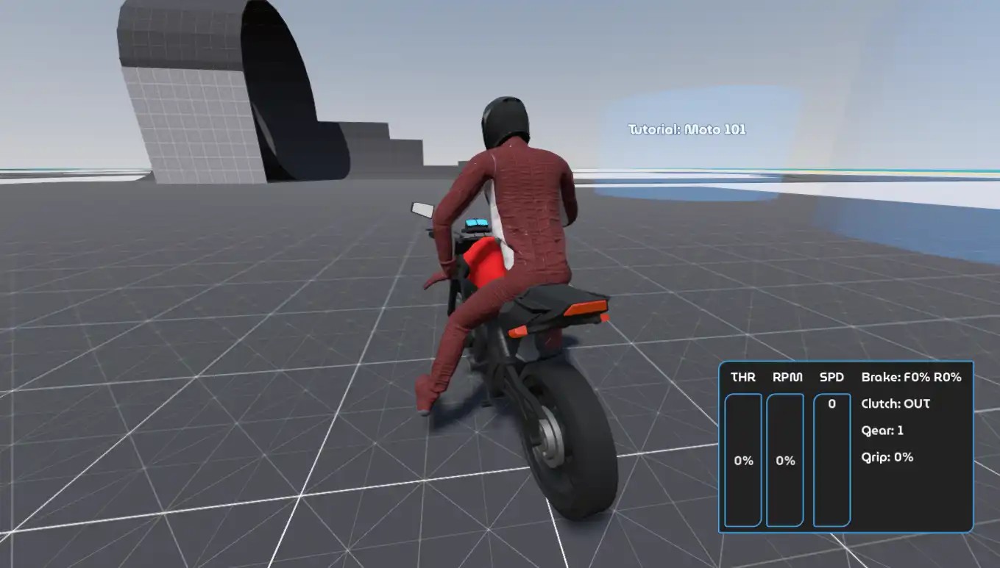

# 

 

**An open-world motorcycle game about doing every stupid thing you'd never try in real life.**

Realistic controls meet arcade tricks: progressive braking, balance point wheelies, ragdoll crashes, and more. Weave through traffic doing 12'oclock wheelies, do FMX tricks off ramps, race friends online, and upgrade your bikes to show them off.

## Play

> Best played with a controller! But Keyboard + Mouse works too

- **Steam:** [Dank Nooner on Steam](https://store.steampowered.com/app/5416370/Dank_Nooner/)
- **Discord:** [discord.gg/HCe4XcCFw3](https://discord.gg/HCe4XcCFw3)
- **V1 POC (wheelie balance):** [itch.io](https://theofficialssebs.itch.io/dank-nooner-poc)

## V2 Status

V2 is the multiplayer open-world rewrite, in active development. For live progress see [planning_docs/TODO.md](./v2/planning_docs/TODO.md).

What works today:

- Free roam multiplayer over Steam (invites, lobby codes) or WebRTC (NAT punch via a signaling server, no port forwarding)
- Server-authoritative physics with client prediction and rollback (netfox)
- Manual gearbox with clutch, RPM, and progressive braking (or automatic)
- 18 tricks: wheelies, stoppies, flips, 360s, superman, kickflip, burnouts, bunny hops, drift wheelies, and more
- Trick combos that earn boost
- Crash detection, ragdoll, and speed wobbles
- Gamemodes: Race, Stunt Race, Time Attack, Wheelie-only race, Trick Battle, and Megaramp Trick Comp, with mid-race challenges and a live leaderboard
- Stunt Race items: bat, shotgun, oil slick, deployable ramp, gas can, and Rally Up
- Fuel-up minigame at gas stations before races and in free roam
- NPC traffic that follows baked lanes through intersections and stops at traffic lights
- In-world garage: earn money from events, spend it on bike and character skins, color slots, mods, and horns
- IK rider animation that adapts per bike (hand and foot markers per `BikeSkinDefinition`)
- Custom engine audio that blends with RPM, plus exhaust pops and burbles, positional for other riders
- Remappable controls, minimap, plus quick and full respawn

What's next (see [TODO.md](./v2/planning_docs/TODO.md)):

- Racing AI, street races with traffic, and near-miss tricks
- More gamemodes (crash-launch, follow-the-leader trick battles) and Stunt Race items
- Progression: unlockable bikes, collectibles, and saved player stats
- Larger map
- Music
- Steam demo
- Story mode (V3)

<!-- TODO: short clip or screenshot of multiplayer free roam -->

## From V1 to V2

V1 was a single-mechanic POC: hold a wheelie as long as you can without flipping. It validated that the balance-point feel was fun on its own ([play it on itch](https://theofficialssebs.itch.io/dank-nooner-poc)). V2 keeps that core feel and builds an open world, multiplayer, and a full trick system around it.

| Phase | Status      | Notes                                                                                                                                        |
| ----- | ----------- | -------------------------------------------------------------------------------------------------------------------------------------------- |
| V1    | Complete    | Wheelie balance POC on itch + standalone player controller ([v1.0](https://github.com/ssebs/moto-player-controller-godot/releases/tag/v1.0)) |
| V2    | In progress | Multiplayer open-world rewrite. Track work in [TODO.md](./v2/planning_docs/TODO.md)                                                          |
| V3    | Planned     | Story mode, quests, full polish                                                                                                              |

Source for each version lives in [v1/](./v1/) and [v2/](./v2/).

POC repos that fed into V2

- [multiplayer-poc-godot](https://github.com/ssebs/multiplayer-poc-godot) - lobby and player sync
- [inverse-kinematics-poc](https://github.com/ssebs/inverse-kinematics-poc) - IK rider animations
- [moto-player-controller-godot](https://github.com/ssebs/moto-player-controller-godot) - controls, physics, tricks, ragdoll
- [danknoonersignalserver](https://github.com/ssebs/danknoonersignalserver/) - WebRTC signaling for NAT traversal (`docker pull ssebs/danknoonersignalserver:latest`)

## Planning Docs

Design notes and current status live in [v2/planning_docs/](./v2/planning_docs/):

- [TODO](./v2/planning_docs/TODO.md) - active work and backlog
- [Architecture](./v2/planning_docs/Architecture.md)
- [GamemodeSystem](./v2/planning_docs/GamemodeSystem.md)
- [StuntRaceGamemode](./v2/planning_docs/StuntRaceGamemode.md)
- [PlayerController](./v2/planning_docs/PlayerController.md)
- [ComboAndBoost](./v2/planning_docs/ComboAndBoost.md)
- [AnimationController](./v2/planning_docs/AnimationController.md)
- [AudioMiddleware](./v2/planning_docs/AudioMiddleware.md)
- [LobbyGameFlowMP](./v2/planning_docs/LobbyGameFlowMP.md)
- [Skins](./v2/planning_docs/Skins.md)
- [Goals](./v2/planning_docs/Goals4Game.md)
- [Story](./v2/planning_docs/Story.md)
- [Marketing](./v2/planning_docs/Marketing.md)

## Media

V1 player controller demo:

V1 multiplayer POC:

<!-- TODO: replace/extend with V2 media once something is stable enough to not rot -->

## License

[AGPL](./LICENSE)
